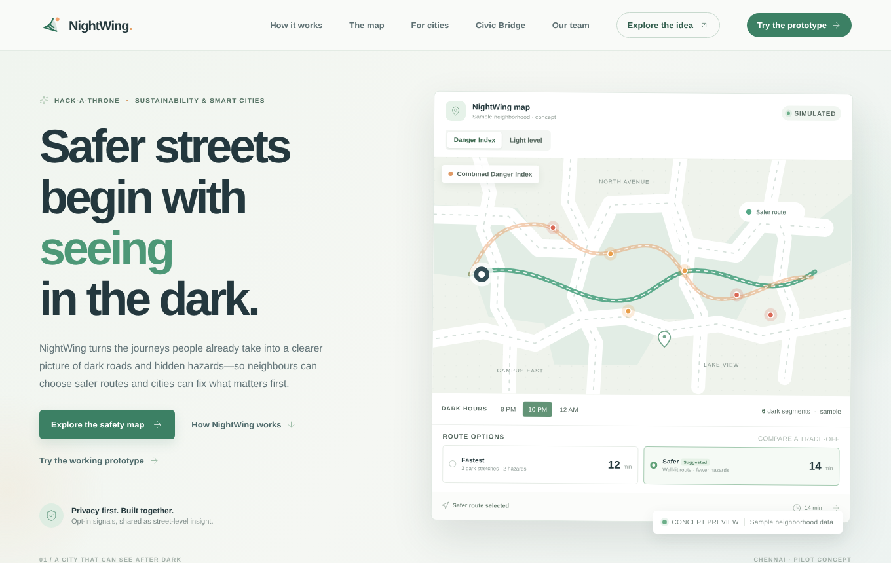

# NightWing 🌙

**Crowdsourced dark-street and pothole mapping for safer night travel.** Team Coding Divas · Hack-A-Throne 2026 · Sustainability & Smart Cities

> ⚠️ Prototype with **simulated** pilot data. Not a live safety service. In an emergency in India, call **112**.

This repository holds the ready-built website and working prototype (`index.html`, served by Vercel and GitHub Pages) and the full source code in [`source/`](source/). Open `/app` to go straight to the prototype.

**Live:** https://night-wing-ruby.vercel.app (prototype: https://night-wing-ruby.vercel.app/app) · also on GitHub Pages: https://team-coding-divas.github.io/NightWing/

## Try the demo
| Role | How to sign in |
|---|---|
| Citizen | Any name and 10-digit mobile number → **Send code** → enter the code shown on screen (demo: no SMS is sent). Women can verify with DigiLocker (demo) to unlock Women's Safety Mode. |
| City official | Tap **Fill demo login** on the City official tab (demo test account). |

**Presenting tips:** press **Reset demo data** on the sign-in screen before you start; open the site in two windows (citizen and official) — they stay in sync; dashed buttons are demo controls.

## Features
- **Citizen app:** Danger map with a Dark Hours slider, SafeRoute (fastest vs. safer) with English/Tamil voice alerts, Report a light (photo, GPS pin, duplicate merging), Help map your street (real camera light meter, bump detector and GPS, added to the map, confirmed once 3 residents measure the same road), and Women's Safety Mode (Ride Watch, Smart Check-In, WhatsApp/SMS alerts with a GPS map link) for verified women.
- **City Authority console:** citizen reports with a 48-hour inspection target, Smart Outage Diagnosis (bulb vs. power cut), ranked repair list with tunable Danger Index weights, repairs closed only by residents, ward report, and the Civic Bridge with a Joint Safety Ledger.

## Repository layout
| Path | What it is |
|---|---|
| `index.html` | The whole website and prototype in one pre-built file |
| `nightwing-config.js` | Optional live-sync setting (Firebase URL) |
| `screenshots/` | Images used in this README |
| `source/` | Full React + TypeScript source (see [`source/README.md`](source/README.md)) |
| `vercel.json` | Tells Vercel to serve the pre-built site with no build step |

## Deploy
- **Vercel:** Add New → Project → import this repository → Deploy (no settings to change).
- **GitHub Pages:** Settings → Pages → Deploy from a branch → `main` / `(root)`.
- Optional live sync across devices: put a Firebase Realtime Database URL in `nightwing-config.js`.

## Team Coding Divas
Prathika (Amrita School of Computing, Chennai) · Githa Shri (SRM Easwari Engineering College) · Rashika Shri (Rajalakshmi Engineering College)

Supports UN SDG 11 and SDG 5. Licensed under [MIT](LICENSE).
