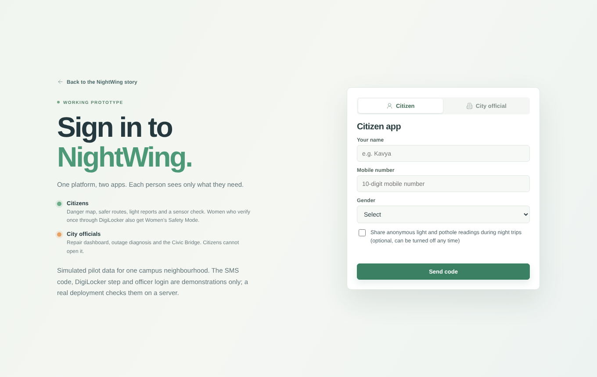
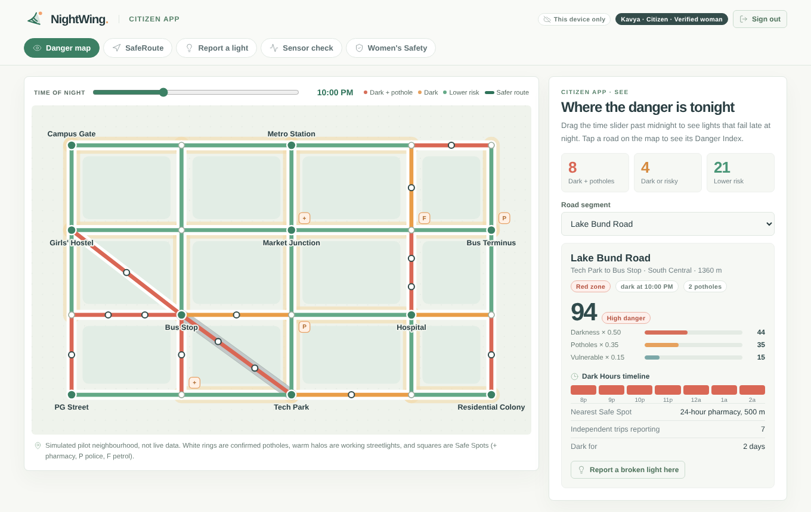
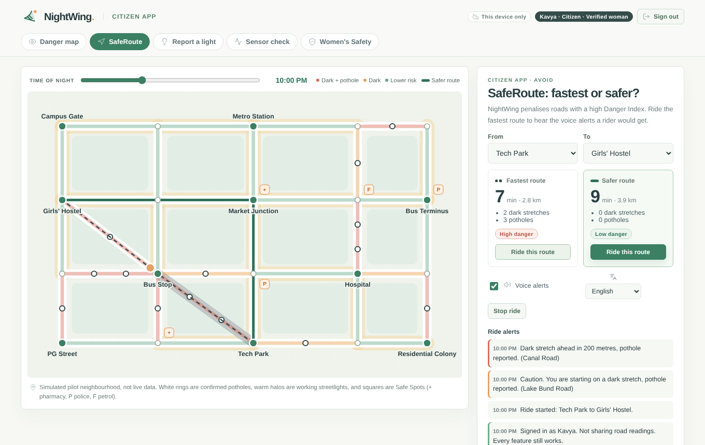
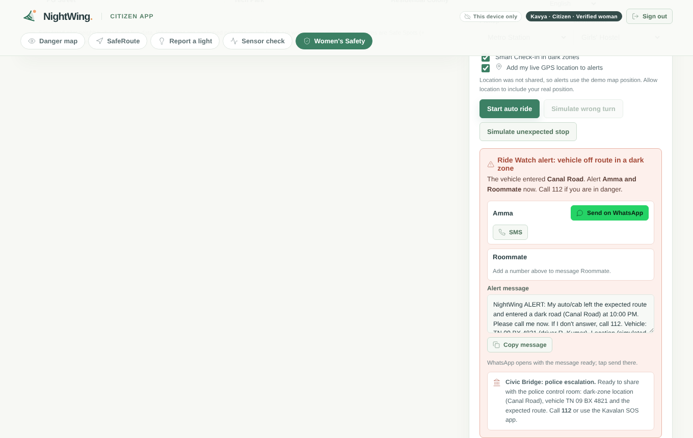
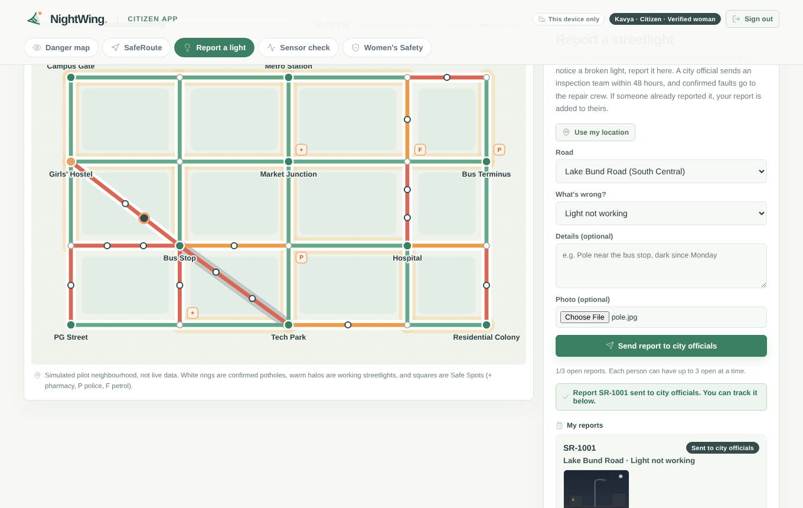
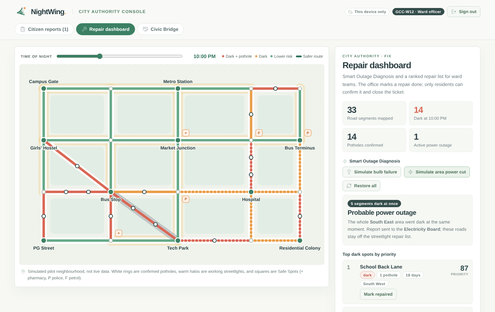
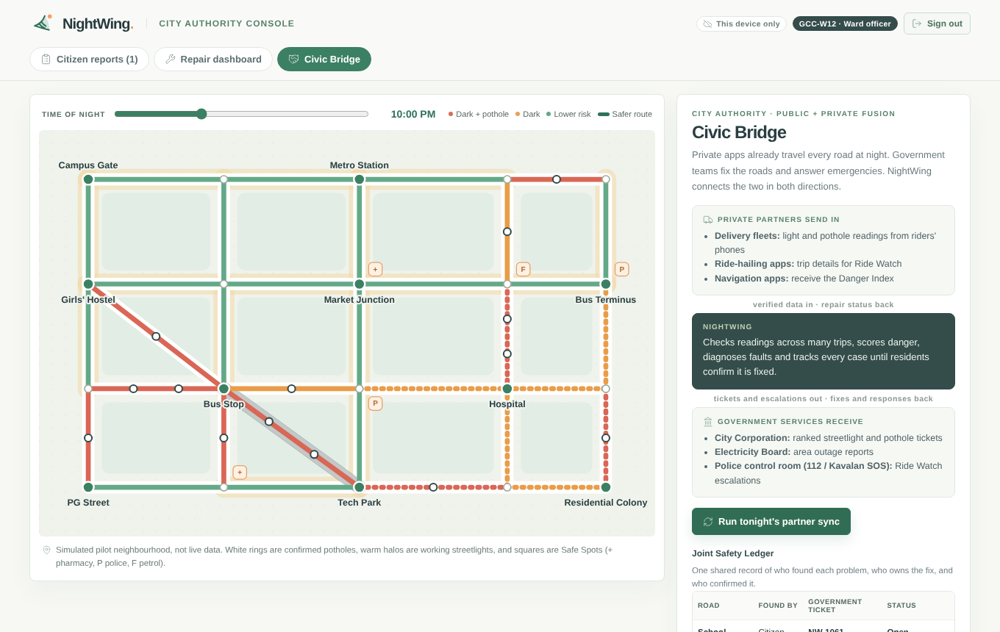

# NightWing 🌙

**Crowdsourced dark-street and pothole mapping for safer night travel.**

NightWing turns the night journeys people already take into a live picture of dark roads and hidden hazards, so people can choose safer routes and cities can fix the right problems first.

Built by **Team Coding Divas** for **Hack-A-Throne 2026** · Domain: **Sustainability & Smart Cities**

> ⚠️ **Prototype notice:** NightWing is a student concept and working prototype. All map data, partners and government departments are **simulated**. It is not a live safety service. In an emergency in India, call **112**.


---

## The problem

Broken and missing streetlights make roads unsafe at night, especially for women, students, night-shift workers and two-wheeler riders. Cities mostly learn about dark streets through one-by-one complaints, so:

- many dark stretches are **never reported**,
- repairs have **no clear priority**, and
- lights are marked "fixed" **without anyone checking**.

Darkness also hides potholes, a **double hazard** for riders that existing tools map separately or not at all.

## The idea

With consent, a phone's **light sensor, accelerometer and GPS** record conditions during night travel. NightWing combines many anonymous readings into one **Danger Index** per road segment:

```
Danger Index = 0.50 × darkness severity + 0.35 × pothole severity + 0.15 × traffic and vulnerable-location score
```

The weights are transparent starting values, to be tuned with pilot data and city engineers.

Every feature fits one of three pillars:

| See | Avoid | Fix |
|---|---|---|
| Danger Index map | SafeRoute (fastest vs. safer) | Smart Outage Diagnosis |
| Dark Hours timeline | Hands-free voice alerts | DarkSpot priority score |
| Darkness heatmap | Safe Spots nearby | Resident repair verification |
| | Women's Safety Mode | Ward repair reports |

---

## Two apps, one platform

Everyone signs in first, and each person sees only what they need.

### 👤 Citizen app
Sign in with a name, mobile number and one-time code. Sharing road readings is optional.

- **Danger map:** roads coloured red (dark + potholes), orange (dark or risky) and green (lower risk), with a Dark Hours slider from 8 PM to 2 AM.
- **SafeRoute:** compares the fastest route with a safer one and plays voice alerts such as *"Dark stretch ahead in 200 metres, pothole reported."*
- **Women's Safety Mode** for women. Everyone can use the map, routes and reports straight away; women verify once through a DigiLocker step (at sign-in or later inside the app) to unlock:
  - **Ride Watch:** alerts trusted contacts if an auto or cab leaves the expected route and enters a dark zone.
  - **Smart Check-In:** asks *"Are you okay?"* after an unexpected stop on a dark stretch.
  - One-tap **WhatsApp / SMS** alerts with the road, vehicle number and a **Google Maps link to the rider's live GPS position**, plus a police escalation card (112 / Kavalan SOS).
  - Voice alerts and alert messages in **English or Tamil** (Tamil alerts include the English text too).
- **Report a light:** residents don't have to keep checking streetlights. Anyone who notices a broken light can report it in a tap (road, problem, note, **photo** and **GPS pin**) and track it: *sent to officials → inspection team checking → confirmed and with repair crew → repaired, residents to confirm → confirmed fixed* (or *checked, light is working*).
  - Reports for the same road are **merged**: a second resident is added as a supporter, which raises the priority.
  - Each person can have **3 open reports** at a time, and officials can close spam or wrong reports.
  - Residents see **updates on their reports** when they next sign in.
  - **Only residents can close a repair.** When the crew says a light is fixed, nearby residents get "Yes, it's lit now / Still dark" buttons.
- **Help map your street:** when a street feels dark, a resident taps **Measure this street**. The phone's **real** sensors do the work: the camera (or ambient light sensor) checks how bright it is, the accelerometer feels for pothole bumps, and GPS picks the nearest road. **Add to map** adds the anonymous reading to that road. One reading is only a hint: each person counts once per road, a road's light level is confirmed after **3 different residents** measure it, and a pothole is added after bumps from **2 residents**, so one person can't make a road look dangerous. *Why it's there:* NightWing's map is built from people's phones, and this is how a citizen contributes; in the full app the same measurement runs automatically during night trips for people who turned on sharing. **Pilot team tools** (folded away) show raw values and export a CSV field log for collecting real pilot data.
- **Keyboard and screen-reader friendly map:** every road can be reached with Tab and opened with Enter.

| Sign-in | Danger map |
|---|---|
|  |  |

| SafeRoute | Ride Watch alert |
|---|---|
|  |  |

| Report a light |
|---|
|  |

### 🏛️ City Authority console
For ward engineers, the electricity board and police. **Citizens cannot open it.**

- **Citizen reports:** officials see every resident report with its photo, GPS pin and number of residents, send an inspection team to check, then mark the result. Each report has a **48-hour inspection target**; overdue reports are flagged and move to the top. A confirmed fault becomes a repair-crew ticket and shows on the map and priority list; a light found working is closed with a thank-you; spam or wrong reports can be closed with a reason.
- **Smart Outage Diagnosis:** one dark segment → probable bulb failure → city corporation. A whole area dark at once → probable power cut → electricity board.
- **Priority-ranked repair list** and a ward report. The office marks a repair done, but **only residents can confirm it** in the citizen app.
- **Tunable Danger Index weights:** city engineers can adjust the 0.50 / 0.35 / 0.15 weights with sliders and see the map, routes and priorities update.
- **Civic Bridge:** connects private apps with government services.
  - Delivery fleets send road readings; ride apps share trip details; navigation apps receive the Danger Index.
  - Tickets go to the city corporation, outages to the electricity board, and Ride Watch escalations to the police control room.
  - A **Joint Safety Ledger** records who found each problem, who owns the fix and who confirmed it.

| Repair dashboard | Civic Bridge |
|---|---|
|  |  |

---

## Try the demo

**Live site:** `https://<project-name>.vercel.app` (Vercel) or `https://<your-github-username>.github.io/nightwing/` (GitHub Pages), both served from `docs/index.html`. Add `/app` (Vercel) or `#app` (either) to open the prototype directly.

You can also run the project locally (see below) and open **`/app`**, or click **Try the prototype** on the landing page.

| Role | How to sign in |
|---|---|
| Citizen | Any name and 10-digit mobile number → **Send code** → enter the code shown on screen (demo: no SMS is sent). Women can tap **Verify with DigiLocker (demo)** at sign-in or later in the **Women's Safety** tab to unlock Women's Safety Mode. |
| City official | Tap **Fill demo login** on the City official tab (test account `GCC-W12` / `4821`). |

> 🔐 **Demo credentials only.** The officer account above is a public test account that exists only in this prototype so judges can open the console. Real officer accounts are issued by the ward office and checked on a server; codes and DigiLocker are also simulated here.

**Presenting tips**
- Press **Reset demo data** on the sign-in screen before you go on stage, so rehearsal reports don't show up.
- Open the site in **two windows** (citizen on one side, official on the other). Windows of the same browser stay in sync with no server, so a report appears on the console straight away.
- **Presenter speed** (on by default in Women's Safety) makes the auto ride faster and Smart Check-In count down 5 seconds instead of 10.
- Press **Test voice** next to the language picker on the presenting laptop. If no Tamil voice is installed, NightWing speaks English and says so.
- Buttons with a **dashed border** are demo controls that stand in for real events (a wrong turn, a power cut, a day passing).
- In **Help map your street**, tap **Measure this street**, then **Add to map**: your real reading changes that road's Danger Index in front of the judges. Pick a road you won't use later in the demo, because a "lit" reading on Hostel Road stops the Ride Watch alert there.

**Suggested demo flow**
1. Danger map: drag the time slider past midnight and watch lights fail.
2. SafeRoute: ride the **fastest** route from Tech Park to Girls' Hostel to hear voice alerts.
3. Report a light: as a citizen (e.g. *Kavya*), report a broken light with **Use my location** and a photo. Sign in as a second citizen and report the same road to see the reports merge.
4. Women's Safety: sign in as a woman, open **Women's Safety (verify)** and verify (the DigiLocker screen can be allowed or denied). Add your number as a trusted contact, **Import trip**, **Start auto ride**, then **Simulate wrong turn**. Send the alert on WhatsApp; switch the language to Tamil to see the Tamil alert.
5. Sign out and sign in as an official: open **Citizen reports**, tap **Demo: skip ahead one day** twice to see the 48-hour overdue flag, send an inspection team, confirm the fault, then **Repair crew: mark fixed**.
6. Sign back in as the citizen: the update banner appears, and **Confirm repairs near you** closes the ticket.
7. Repair dashboard: simulate a **power cut** and a **bulb failure**, tune the Danger Index weights, and generate the ward report.
8. Civic Bridge: **Run tonight's partner sync** and watch the Joint Safety Ledger fill in.
9. On a phone, open the live link and try **Help map your street** on a real street, then **Add to map**.

---

## Tech stack

**This prototype**
- React 19 + TypeScript, Vite, Tailwind CSS
- Express + tRPC server scaffold (Manus web template), Drizzle ORM
- Routing and Danger Index logic in `client/src/prototype/engine.ts` (Dijkstra over a simulated road graph)
- Browser Speech Synthesis for voice alerts; WhatsApp / SMS deep links for alerts

**Planned production stack**
- React Native or Flutter app; React web console
- Phone light sensor, accelerometer, gyroscope and GPS
- Python (Pandas, Scikit-learn, TensorFlow Lite) for filtering, calibration and pothole classification
- PostgreSQL + PostGIS, OpenStreetMap, OSRM / GraphHopper, Overpass API for Safe Spots
- Officer accounts with role-based access, an SMS gateway and partner APIs for the Civic Bridge

## Project structure

```
client/
  src/
    pages/Home.tsx            Landing page (story, map preview, two apps, Civic Bridge)
    pages/Prototype.tsx       Working prototype: sign-in, citizen app, authority console
    prototype/engine.ts       Simulated road network, Danger Index (tunable weights), routing, diagnosis, GPS helpers
    prototype/prototype.css   Prototype styles (site palette)
    landing-additions.css     Styles for the new landing sections
    components/               Map preview, outage demo, UI components
server/                       Express + tRPC scaffold
docs/index.html               Ready-built single-file site for GitHub Pages
docs/nightwing-config.js      Optional live-sync settings
docs/screenshots/             Images used in this README
.github/workflows/check.yml   Type-check and build on every push
```

## Publishing on GitHub Pages

`docs/index.html` is a ready-built, single-file copy of the website and prototype, so GitHub Pages can serve it with no build step:

1. Go to **Settings → Pages** in the repository.
2. Under **Build and deployment**, choose **Deploy from a branch**, branch **main**, folder **/docs**, and save.
3. After a minute or two the site is live at `https://<your-github-username>.github.io/nightwing/`.

If you change the source code, rebuild the site and replace `docs/index.html` with the new build.

## Deploying on Vercel

The repository includes a `vercel.json` that serves the ready-built site in `docs/`, so Vercel needs no install or build step:

1. Push this repository to GitHub.
2. On [vercel.com](https://vercel.com), sign in with GitHub → **Add New… → Project** → pick the repository → **Import**.
3. Leave every setting as it is (Vercel reads `vercel.json`) and press **Deploy**.
4. The site is live at `https://<project-name>.vercel.app`; the prototype opens at `/app`.

Every push to `main` redeploys automatically. If you change the source code, rebuild `docs/index.html` first.

## Live sync across devices (optional)

By default every browser keeps its own copy of the reports (localStorage), so the citizen and the official must use the same browser. To let a citizen's phone and an official's laptop share the same data:

1. Create a free Firebase project → **Build → Realtime Database → Create database** (any region, start in *test mode*).
2. Copy the database URL (for example `https://nightwing-demo-default-rtdb.asia-southeast1.firebasedatabase.app`).
3. Put it in `docs/nightwing-config.js` (and `client/public/nightwing-config.js` for the dev server):
   ```js
   window.NIGHTWING_CONFIG = { databaseURL: "https://nightwing-demo-default-rtdb.asia-southeast1.firebasedatabase.app" };
   ```
4. Commit and push. The header chip changes from **This device only** to **Live sync**, and changes reach other devices within about 4 seconds.

For the demo the database can use these rules (open to anyone with the link, so **don't store real personal data**):
```json
{ "rules": { "nightwing": { ".read": true, ".write": true } } }
```
A production version would use Firebase Authentication with per-role rules, or the PostGIS server described below. Any server that answers `GET` / `PUT` on `/nightwing/state.json` with the same JSON works too.

## Getting started

Requirements: Node.js 20+ and pnpm.

```bash
pnpm install
pnpm dev          # development server on PORT (default 3000)
```

Then open `http://localhost:3000` (landing page) and `http://localhost:3000/app` (prototype).

Other scripts:

| Command | What it does |
|---|---|
| `pnpm build` / `pnpm start` | Build and serve `dist/index.js` and `dist/public/` |
| `pnpm build:static` | Build the front end only |
| `pnpm check` | Type-check (also run by GitHub Actions on every push, see `.github/workflows/check.yml`) |
| `pnpm test` | Run tests |
| `pnpm db:migrate` / `pnpm db:push` | Apply or generate database migrations |

## Privacy and responsible design

- Sensing is **opt-in** and off by default.
- Only **coarse, aggregated** road-segment data is stored; individual routes are never shown.
- Women's verification keeps only a "verified" flag, never documents.
- Report photos are shrunk to a small thumbnail; the sensor field log stays on the device until you export it.
- Location and ride details reach trusted contacts or police **only when the rider's alert fires**.
- Scores describe lighting and road hazards; they are **not a guarantee of personal safety**.

### Prototype limitations
- Codes, DigiLocker verification and officer login are checked in the browser for demonstration. A production app would send real SMS codes and verify accounts on a server.
- The road network and its light and pothole values are simulated. The **Help map your street** tab is real, and is how pilot data will be collected; the camera light meter is a rough guide until it is calibrated against a lux meter.
- Live sync is last-writer-wins and has open demo rules; it is for demos, not production.
- Alerts open WhatsApp or SMS with the message ready; the user taps send.
- Partner apps and government departments are simulated; these integrations are planned, not live.

## Team Coding Divas

| Member | College |
|---|---|
| Prathika | Amrita School of Computing, Chennai |
| Githa Shri | SRM Easwari Engineering College |
| Rashika Shri | Rajalakshmi Engineering College |

Supports UN SDG 11 (sustainable cities) and SDG 5 (gender equality).

## License

[MIT](LICENSE)
